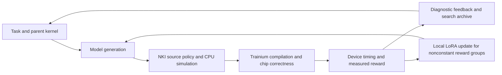

# TTT-Discover on Trainium: engineering contribution and verification report


## Delivered contribution and hardware-access context

This project delivers a hardware-validated NKI fused-softmax evaluator and a
local Trainium training prototype derived from
**[TTT-Discover](https://github.com/test-time-training/discover)**. Completed
experiments establish kernel correctness and device timing, plus four-way
tensor-parallel LoRA execution and checkpoint restoration on selected real
GPT-OSS-20B layers. The broader discovery loop is implemented but has not
completed an end-to-end hardware validation run.

Development took place during the NYU × Annapurna Labs workshop with access to
a Trainium2 seat. **The contributor maintaining this handoff no longer has access
to that seat.** The deliverable is therefore the implemented infrastructure,
completed verification gates, and preserved evidence. Further device validation
requires a maintainer or collaborator with suitable hardware. Loss of access
explains the current validation boundary; it does not establish that the full
model or discovery paths would succeed on another run. No new hardware run is
claimed for this documentation revision.

## Attribution and adaptation

[TTT-Discover](https://github.com/test-time-training/discover), accompanying
*Learning to Discover at Test Time*, supplies the upstream test-time learning
and search implementation. This port uses reference commit
[`6c40e82dab9d5de7416ac873ad5cd3106084aaed`](https://github.com/test-time-training/discover/tree/6c40e82dab9d5de7416ac873ad5cd3106084aaed).
Credit for the retained algorithms belongs to the upstream authors. This project
does not claim to originate those algorithms or reproduce their published results.

| Derived from TTT-Discover | Implemented for this Trainium project |
| --- | --- |
| State representation and PUCT parent sampling | NKI fused-softmax contract, correctness evaluator, and device latency rewards |
| Adaptive entropic advantages and constant-reward group handling | Local PyTorch/Neuron LoRA backend replacing the Tinker service dependency |
| GPT-OSS rendering and two-phase completion | TP4 attention/expert sharding and replicated adapter-gradient reduction |
| Selected persistence and completion utilities | Worker lifecycle, policy fingerprints, checkpoint/resume integration, and hardware verification tooling |

The [runtime provenance manifest](../trainium-softmax/rl/vendor/PROVENANCE.json)
records retained code and local changes. [Reference snapshots](../discover-reference/README.md)
support AST parity tests and are not imported at runtime. Upstream MIT notices
are retained in the reference and vendor directories. This is a focused port,
not a replacement for the full upstream launcher or its GPU environments.

## What this was intended to plug into

The destination is the NYU × Annapurna Labs workshop repository,
[`yahavb/trainium-agent-labs`](https://github.com/yahavb/trainium-agent-labs).
Its central loop is: a model proposes a solution, a checker evaluates it,
and the next prompt includes the score and diagnostic feedback. Project 1
applies that pattern to a heat-equation problem; Project 2 applies it to NKI
kernel generation. Local Qwen3-8B or the shared GPT-OSS-20B service supplies
inference through a vLLM endpoint.

At the inspected target revision
`8f1ca418827a3b4adc88a766262d065b639b7d46`,
[Project 2](https://github.com/yahavb/trainium-agent-labs/blob/8f1ca418827a3b4adc88a766262d065b639b7d46/projects/02-kernel-agent/README.md)
describes a CPU simulator checker and a missing device correctness/timing
layer. This contribution supplies a standalone fused-softmax task with those
device checks and measurements, and adds a focused Discover-style training
and search implementation. It is an additive project, not a completed adapter
for every existing level of the workshop's kernel ladder. Existing
`projects/02-kernel-agent/agent.py` is not modified or redirected automatically.

The planned integration has two parts:

1. Use the softmax evaluator's diagnostics and measured latency as feedback
   for a model-generated candidate. An adapter to the original workshop agent
   would need to select this task contract and translate evaluator results
   into that agent's feedback interface.
2. Replace inference-only retries with Discover's parent selection and
   reward-weighted local LoRA updates. This requires a trainable checkpoint;
   a shared inference endpoint cannot perform the local optimizer update.



The diagram describes the implemented orchestration. It is not evidence that
a complete task-driven training/search run has succeeded.

## What was implemented

`trainium-softmax/loop.py` defines a fixed fused-softmax contract: four shapes,
two input dtypes and three additive-mask modes. Stable softmax must preserve
output shape/dtype and leave inputs unchanged. The evaluator applies source
restrictions, runs 72 CPU simulator cases, compiles eight shape/dtype
specializations, and runs all 72 chip cases before invoking timing. Accepted
kernels receive 24 device-traced benchmarks with 10 warmups and 100 iterations
per case. The aggregate is geometric-mean latency; reward is 1000 divided by
latency in microseconds. Simulation produces no speed reward.

The focused port in `trainium-softmax/rl/` retains upstream PUCT parent
selection, adaptive entropic advantages and GPT-OSS two-phase completion.
Constant-reward groups are excluded from training. Failed candidates get zero
reward. Policy versions and adapter fingerprints prevent stale rollout use;
search state and checkpoint paths support resume. Upstream source snapshots,
AST parity tests, provenance and MIT license are preserved.

The training backend uses local GPT-OSS checkpoint weights, BF16-dequantized
MXFP4 experts, Transformers eager attention and rank-32 attention LoRA. TP4
shards attention heads/projections and expert intermediate channels; selected
replicated adapter gradients are summed. Fixed-shape dense expert evaluation
avoids dynamic routing indices but costs more computation than sparse routing.
Sampling and training execute in separate worker processes so they release
device cores before kernel evaluation starts.

## Qwen3-8B: the recorded compatibility problem

The model in the workshop record is **Qwen/Qwen3-8B**, not a model named
“Qwen 3.8.” The target's [environment notes](https://github.com/yahavb/trainium-agent-labs/blob/8f1ca418827a3b4adc88a766262d065b639b7d46/STATE.md)
and [container explanation](https://github.com/yahavb/trainium-agent-labs/blob/8f1ca418827a3b4adc88a766262d065b639b7d46/README.md#why-a-container-when-the-instance-already-has-vllm)
record that the AMI's preinstalled vLLM-Neuron 0.21 environment lacked the
required text-model integration. Starting it with Qwen3-8B raised:

```text
AttributeError: type object 'Qwen3ForCausalLM' has no attribute 'from_configs'
```

That recorded error identifies a model/backend integration gap; it does not
establish that Qwen3-8B cannot execute on Trainium2 silicon or that the NKI
kernel compiler failed. Qwen3-VL support is also not evidence of support for
the distinct Qwen3 text-model architecture. The workshop records using its
0.24 container as the working alternative. During this contribution's
experiments, the seat's existing Qwen3-8B TP2 service was running on Trainium2
and returned HTTP 200 after restoration. Those are environment-specific
observations, not a claim that every release supports this model.

The exact Qwen support matrix must be checked against the selected release.
The [0.24.0.1.1.0 plugin README](https://github.com/vllm-project/vllm-neuron/blob/release-0.24.0.1.1.0/README.md)
lists tested Qwen3-VL and Qwen3-Embedding families rather than a general
Qwen3-8B text-model guarantee. The successful workshop deployment and that
tested-model list are separate pieces of evidence. No additional failing
chip/model combination was established in this contribution.

## Uniform serving interface, hardware-specific implementation

vLLM gives the workshop a common serving interface: agents configure a base
URL and served model identifier, then use the same chat-completion request
structure. The Neuron plugin explicitly preserves vLLM APIs and familiar
configuration. Its [release compatibility matrix](https://github.com/vllm-project/vllm-neuron/blob/release-0.24.0.1.1.0/README.md)
distinguishes the newer plugin for Trn2/Trn3 from the NxD Inference-backed
plugin line supporting Inf2/Trn1/Trn2.

Uniform API structure does not make the execution stack identical. Backend
and model adapters, SDK/compiler versions, tensor parallelism, core exposure,
LNC, memory allocation and compiled shapes must match the deployment. The
[AWS inference overview](https://awsdocs-neuron.readthedocs-hosted.com/en/latest/libraries/vllm-neuron/neuron-inference-overview.html)
describes these separate Neuron inference paths. This report verifies one
Trainium2 seat configuration; it makes no cross-generation portability claim.

| Component | Shared structure | Deployment-specific details |
| --- | --- | --- |
| Workshop agent | Prompt → completion → checker feedback | Endpoint, served model, generation controls |
| vLLM service | Common serving API | Model adapter, plugin/build, TP, caches, core allocation |
| NKI evaluator | Fixed task contract and result schema | Compiler/runtime, target, compiled artifacts |
| Local training | Rollout → loss → update → checkpoint | Trainable weights, sharding, memory fit, core assignment |

The shared GPT-OSS service exposes aggregated and disaggregated routes through
the same model-facing API. The workshop's [endpoint documentation](https://github.com/yahavb/trainium-agent-labs/blob/8f1ca418827a3b4adc88a766262d065b639b7d46/gptoss/README.md)
describes different serving topologies behind those routes. This contribution's
local LoRA backend operates on checkpoint weights rather than through either
remote inference route.

## What was actually verified

| Gate | Evidence and limit |
| --- | --- |
| Seed kernel | 72 simulator and 72 chip correctness cases; 24 benchmarks; 207.8703 µs geometric mean. Locally written, not model-generated. |
| CPU software | Seven evaluator tests, ten RL tests, one four-process TP4 parity test and two partial-model tests passed. Mock orchestration is not device performance. |
| Tiny TP4 hardware | Forward, finite nonzero gradients, one update, updated-policy generation and checkpoint restore on all four ranks. |
| Partial GPT-OSS-20B hardware | Original layers 0/6/12/17/23; eight-token input, one token per sample and one optimizer update. All four ranks passed; global gradient norm 433.7534582; matching updated/restored global hash; no fallback ops. |

Partial extraction preserved 98 source tensor hashes, original layer names and
indices, original config fields, sliding attention at 0/6/12 and full attention
at 17/23. It retained embeddings, final norm and LM head. Removing other
layers changes the model function, so this does not measure full-model quality.
The partial gate used a synthetic +1 advantage to isolate update mechanics;
it was not driven by measured kernel rewards.

The seed's absolute latency is a baseline measurement, not evidence of a
performance improvement or competitiveness against an optimized library kernel.
Its row-sequential implementation leaves row tiling as a future optimization
hypothesis that requires hardware measurement. The CPU software results include
mocked orchestration and cannot establish accelerator performance. The recorded
prepared upstream checkout passed all 20 software tests; those historical checks
and device experiments were not rerun for this documentation revision.

Reviewable artifacts include [per-case seed timings](../trainium-softmax/evidence/seed-hardware/best.json),
the [seed implementation](../trainium-softmax/evidence/seed-hardware/best.py),
[evaluator tests](../trainium-softmax/evidence/continuation/evaluator-tests.txt),
[training tests](../trainium-softmax/evidence/continuation/training-tests.txt),
[tensor provenance](../trainium-softmax/evidence/continuation/partial-provenance.json),
and [recorded handoff validation](HANDOFF_VALIDATION.json).

The bounded partial run used 17.32 minutes of hardware testing. Cleanup and
evidence capture completed about 25.26 minutes after its clock started, and
the final push followed within the deadline. Qwen was restored and healthy;
experiment workers exited. The [summary](../trainium-softmax/evidence/continuation/partial-tp4/summary.json),
per-rank events/results, tensor provenance and full session log are tracked.

## Handoff after workshop hardware access

Full GPT-OSS-20B TP4 training, an end-to-end task-driven Discover iteration,
and model-generated kernel speedups remain unverified. The earlier full-model
attempt was cancelled during initialization when the scope changed. The later
request to generate kernels was interrupted before any candidate was written;
there are no new generated kernels to include in this handoff.

With seat access ended, the next hardware work is a bounded validation plan for
a future maintainer, rather than a prerequisite for presenting the completed
engineering contribution:

1. Recreate the [pinned environment](../trainium-softmax/rl/README.md) and rerun
   seed correctness/timing and TP4 mechanics on an idle device with fresh outputs.
2. Establish full-model memory fit and forward/backward compilation before
   claiming full GPT-OSS-20B training. The earlier EP2 backward compilation
   encountered a recorded memory failure; full TP4 remains unverified.
3. Execute a discovery group with nonconstant measured task rewards, preserve
   the resulting update, and generate from the updated policy.
4. Compare accepted candidates against the seed under identical conditions,
   reporting per-shape timings and repeated measurements before claiming speedup.

CPU tests, documentation, and evidence inspection can continue without a seat.
Mocked tests cannot extend the hardware claims. An adapter into the workshop's
original kernel-agent ladder remains separate work. Runtime artifacts are
excluded; a fresh clone needs pinned setup and checkpoint download. The
[handoff guide](HANDOFF.md) describes the proposed additive transfer, and the
[PR draft](PR_DESCRIPTION.md) states the verified scope. A prepared draft is
not a submitted or accepted upstream PR.
